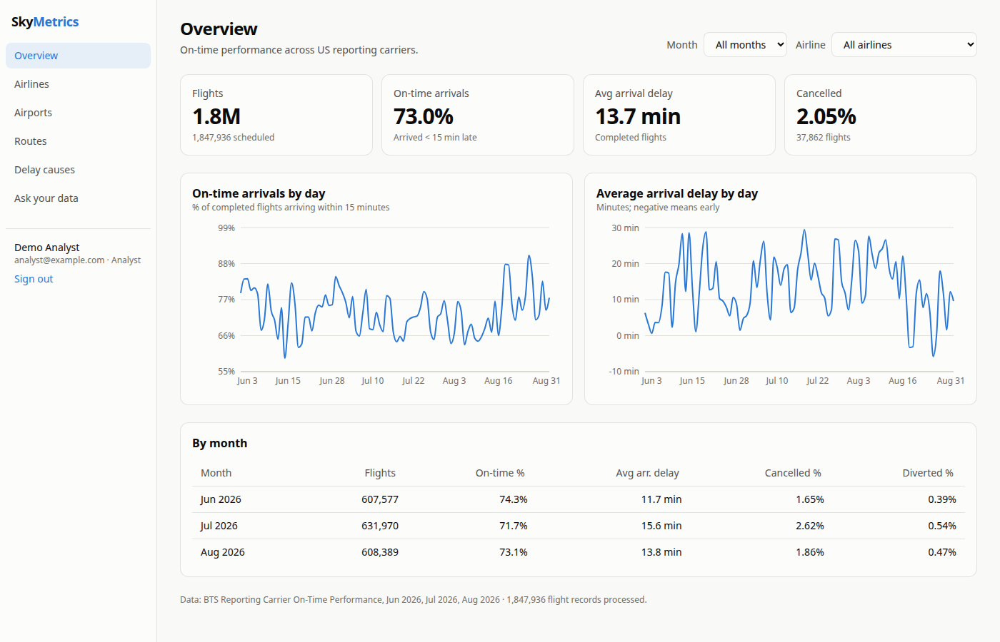
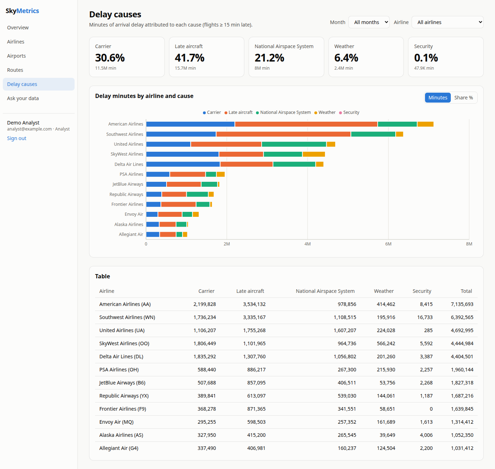
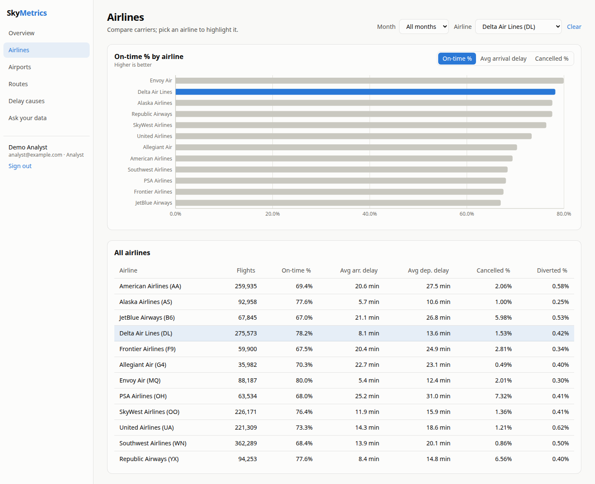
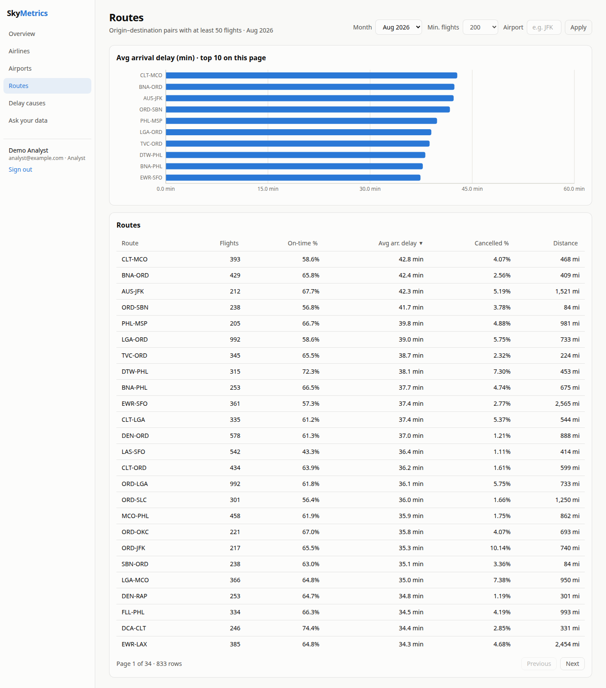
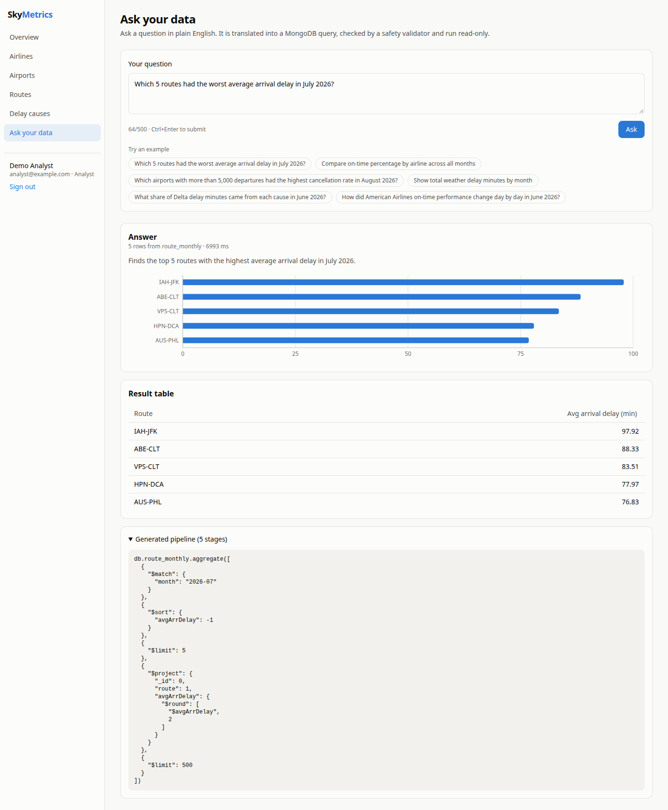
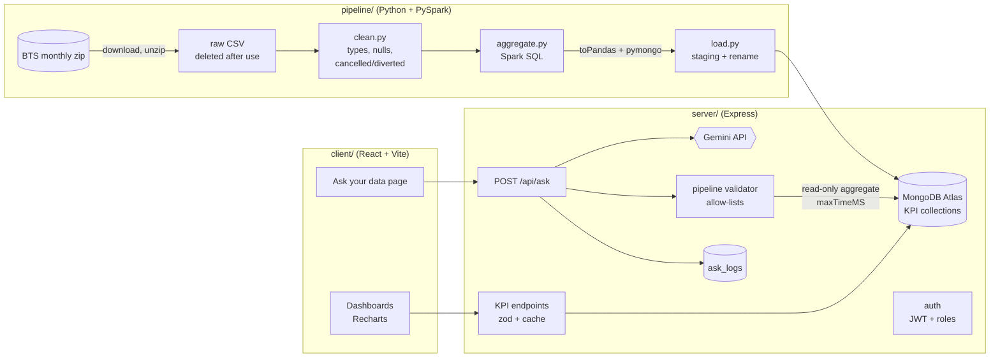
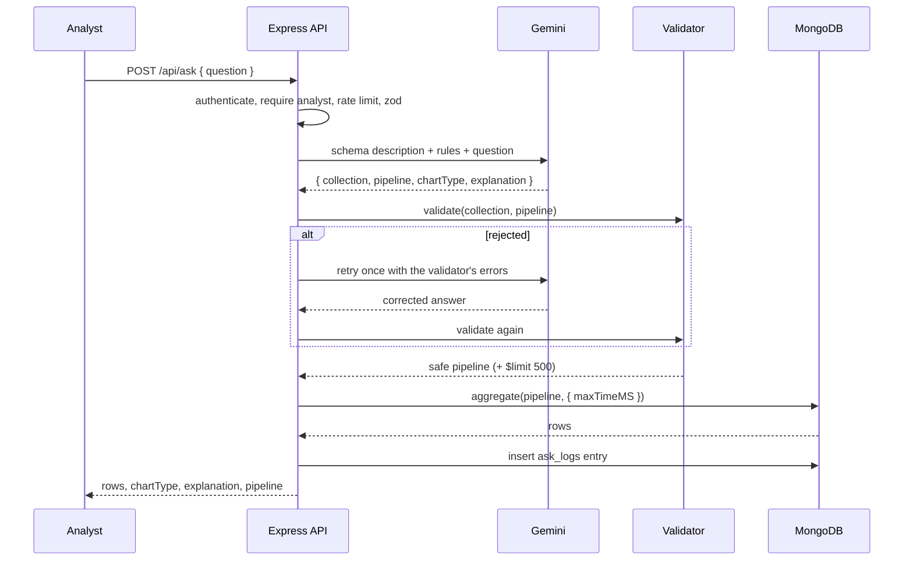

# SkyMetrics

**Aviation analytics dashboard over real US airline on-time performance data, with a natural-language "Ask your data" feature.**

SkyMetrics runs a PySpark pipeline over the U.S. Bureau of Transportation Statistics (BTS) on-time dataset and writes compact KPI collections to MongoDB. A MERN app serves interactive dashboards on top of them. Analysts can also ask questions in plain English, such as *"Which 5 routes had the worst average arrival delay in July 2026?"*. Gemini translates the question into a MongoDB aggregation pipeline, and an allow-list validator checks that pipeline before it runs read-only.

| Overview | Delay causes |
| --- | --- |
|  |  |
| **Airlines** | **Routes** |
|  |  |

**Ask your data** — a live Gemini answer: validated pipeline, auto-chosen chart, result table and the generated pipeline:



---

## Contents

- [Features](#features)
- [Architecture](#architecture)
- [Tech stack](#tech-stack)
- [Getting started](#getting-started)
- [Data pipeline](#data-pipeline)
- [API](#api)
- [Ask your data: how the query-safety validator works](#ask-your-data-how-the-query-safety-validator-works)
- [Testing and CI](#testing-and-ci)
- [Pipeline metrics](#pipeline-metrics)
- [Design decisions](#design-decisions)
- [Limitations and next steps](#limitations-and-next-steps)
- [Dataset and citation](#dataset-and-citation)

## Features

- **Dashboards**:
  - Overview: KPI tiles and daily on-time / delay trends.
  - Airlines: comparison with the selected airline highlighted.
  - Airports: departure performance.
  - Routes: a server-sorted, paginated table plus a chart.
  - Delay causes: stacked bars in minutes or share %.
- **Global filters** (month, airline) are stored in the URL, so every view can be shared and survives a reload.
- **Ask your data** (analysts only): the app shows a result table, an automatically chosen chart (bar, line, pie or stat tile), a plain-English explanation, and the exact generated pipeline in a collapsible panel.
- **Auth**:
  - JWT with bcrypt-hashed passwords.
  - Two roles, `analyst` and `viewer`.
  - Public registration always creates viewers.
- **API hardening**:
  - `helmet`, CORS allow-list, and zod validation of every input (unknown query parameters are rejected).
  - Global rate limit plus a stricter per-user limit on the LLM endpoint.
  - Centralised JSON errors and in-memory caching of KPI responses.
- **Light and dark themes**, responsive down to phone width.

## Architecture



**Request flow for "Ask your data":**



## Tech stack

| Layer | Technology |
| --- | --- |
| Data pipeline | Python 3.12, PySpark 3.5 (Spark SQL), pandas, pymongo, pytest, ruff |
| Database | MongoDB Atlas (M0 free tier); `mongodb-memory-server` for tests |
| API | Node.js, Express 5 (ES modules), native MongoDB driver, zod, jsonwebtoken, bcryptjs, helmet, express-rate-limit, `@google/genai` |
| Frontend | React 19, Vite, React Router, Recharts, Tailwind CSS, axios |
| Testing | pytest, Jest + Supertest, Vitest + React Testing Library |
| Tooling | ESLint, Prettier, ruff, GitHub Actions, Docker (CI/cloud builds only) |

## Getting started

### Prerequisites

- Node.js 20+ (developed on 24), Python 3.10+ (developed on 3.12), Java 11 or 17 (for Spark).
- A MongoDB Atlas cluster (the free M0 tier is plenty; the KPI collections use about 4 MB) and a Gemini API key from Google AI Studio.

### 1. Configure

```bash
cp .env.example .env
# fill in MONGODB_URI, GEMINI_API_KEY and JWT_SECRET (openssl rand -hex 32)
```

Both the pipeline and the server read the same root-level `.env`.

### 2. Run the pipeline

```bash
cd pipeline
python -m venv .venv
source .venv/bin/activate          # Windows: .venv\Scripts\activate
pip install -r requirements-dev.txt
python -m skymetrics_etl.run --months 2026-06 2026-07 2026-08
```

Each month is downloaded, processed and deleted before the next one starts. The run stops if less than 2 GB of disk is free. Use `--dry-run` to compute without writing to MongoDB, or `--csv path/to/file.csv` to process a local file.

### 3. Run the API

```bash
cd server
npm install
npm run seed      # creates analyst@example.com / Analyst123! and viewer@example.com / Viewer123!
npm run dev       # http://localhost:4000
```

### 4. Run the client

```bash
cd client
npm install
npm run dev       # http://localhost:5173 (proxies /api to :4000)
```

### Docker (CI / cloud)

`server/Dockerfile` and `client/Dockerfile` (multi-stage build served by nginx, with `/api` proxied to `API_UPSTREAM`) are built in CI. They are not needed for local development.

## Data pipeline

`pipeline/skymetrics_etl/`

| Module | Responsibility |
| --- | --- |
| `download.py` | Checks free disk space, streams the BTS monthly zip, extracts only the CSV to a fixed file name (member paths are not trusted), and always deletes the zip. |
| `clean.py` | Reads all columns as strings, selects the 14 needed ones, and casts types in one place. Drops rows without a valid date, airline or 3-letter airports. Nulls both delays for cancelled flights and the arrival delay for diverted flights. Turns missing cause minutes into 0. |
| `aggregate.py` | Spark SQL over a temp view for carrier, airport, route and daily KPIs; the DataFrame API for delay causes. Pure functions from DataFrame to DataFrame. |
| `load.py` | `toPandas()` converts results to native Python values (NaN becomes null). The data is written to `<name>__staging`, indexed, then renamed over the live collection (`dropTarget`). If rename is not allowed, it falls back to drop and insert. |
| `run.py` | CLI. Processes one month at a time, deletes the raw CSV in a `finally` block, and records a `pipeline_runs` document. |

**Collections** (all replaced on every run, so re-running is idempotent):

| Collection | Grain | Key metrics |
| --- | --- | --- |
| `carrier_monthly` | airline × month | flights, completed, cancelled, diverted, onTimePct, avgArrDelay, avgDepDelay, cancelPct, divertPct |
| `airport_monthly` | origin airport × month | same counts, onTimeDepPct, avgDepDelay |
| `route_monthly` | origin–destination × month (≥ 50 flights) | arrival metrics + distance |
| `delay_causes_monthly` | airline × month | minutes by carrier / weather / NAS / security / late aircraft |
| `carrier_daily` | airline × day | arrival metrics (powers the daily trend charts) |
| `pipeline_runs` | one per run | rows read, rows after cleaning, per-month timings, document counts |

**Metric definitions:** a flight is *on time* if it was completed (not cancelled or diverted) and arrived less than 15 minutes late, which is the BTS definition. Airport KPIs use departure delay. When the API or client combines several rows, on-time % and average delays are weighted by completed flights, and cancellation and diversion rates by total flights.

## API

All routes are under `/api`. Every KPI route requires a bearer token.

| Method | Path | Notes |
| --- | --- | --- |
| GET | `/health` | DB ping; 503 when degraded |
| POST | `/auth/register` | Always creates a `viewer` |
| POST | `/auth/login` | Returns `{ token, user }` |
| GET | `/auth/me` | Current user |
| GET | `/kpi/overview?month&airline` | Weighted summary, monthly and daily series, last pipeline run |
| GET | `/kpi/filters` | Months, airlines (with names), top airports |
| GET | `/kpi/carriers?month&airline&sort&page&limit` | Paginated |
| GET | `/kpi/airports?month&airport&minFlights&sort&page&limit` | Paginated |
| GET | `/kpi/routes?month&origin&dest&airport&minFlights&sort&page&limit` | `airport` matches either end |
| GET | `/kpi/delay-causes?month&airline` | |
| POST | `/ask` | `analyst` only; 10 requests per minute per user |

Errors always look like `{ "error": { "message": "...", "details": ... } }`.

## Ask your data: how the query-safety validator works

The LLM's output is treated as untrusted input. `server/src/ask/validator.js` walks the whole pipeline and **rejects anything that is not explicitly allowed**:

1. **Collection allow-list.** Only the five KPI collections can be queried. `users`, `ask_logs` and system collections cannot be reached, and lookups use `Object.hasOwn`, so `__proto__` cannot match.
2. **Stage allow-list.** Only `$match`, `$group`, `$sort`, `$limit`, `$project`, `$addFields`, `$count` and `$unwind` are allowed. `$out`, `$merge`, `$lookup`, `$graphLookup`, `$unionWith`, `$facet` and friends get a specific "forbidden" message. Every other stage is rejected as "not allowed".
3. **Operator allow-lists per context.** There are separate lists for query operators in `$match`, accumulators in `$group`, and expression operators. `$where`, `$function`, `$accumulator`, `$regex` (ReDoS risk), `$text` and `$literal` are rejected wherever they are nested, for example `$function` inside a `$sum` inside a `$group`.
4. **Field tracking.** The validator knows which fields exist after each stage: the schema fields at first, then whatever `$group`, `$project`, `$addFields` and `$count` produce. Every `"$field"` reference, `$match` key and `$sort` key must exist at that point. System variables such as `$$ROOT` and `$$NOW` are rejected.
5. **Shape and size limits:**
   - `$limit` must be an integer from 1 to 500. A final `$limit: 500` is appended unless the pipeline already ends with `$limit` or `$count`.
   - `$in` takes at most 200 literal values, and string literals are capped at 200 characters.
   - Pipelines may have at most 15 stages, 12 levels of nesting and 1,500 nodes.
   - Keys like `__proto__` and `constructor` are rejected.
6. **Execution guard rails.** The pipeline runs with `maxTimeMS` (5 s by default) and `allowDiskUse: false`. Set `MONGODB_READONLY_URI` to run it through a database user that only has the `read` role, for defence in depth.
7. **Retry loop.** If validation fails, Gemini is called once more with the validator's error messages. If the second answer also fails, the API returns 422 with the reasons. Every outcome is written to `ask_logs`: success, rejected, unanswerable, LLM error or query error.

The validator suite (`server/tests/validator.test.js`) contains 87 cases, most of them malicious or invalid pipelines.

## Testing and CI

| Part | Tooling | Tests | Coverage |
| --- | --- | --- | --- |
| Pipeline | pytest (local Spark session, in-repo sample CSV) | 29 | 91% statements |
| Server | Jest + Supertest + mongodb-memory-server, Gemini mocked | 159 | 96% statements / 89% branches / 98% lines |
| Client | Vitest + React Testing Library | 49 | 80% statements / 82% branches |

```bash
cd pipeline && pytest
cd server && npm run test:coverage
cd client && npm test
```

The GitHub Actions workflow `.github/workflows/ci.yml` runs on every push and pull request:

- **pipeline:** Java 17 + Python 3.12, ruff, pytest.
- **server:** lint, Prettier check, Jest with coverage.
- **client:** lint, Prettier check, Vitest, production build.
- **docker:** builds both images without pushing them.

## Pipeline metrics

Measured on a laptop (`local[4]`, 2 GB driver memory) for June to August 2026:

| Metric | Value |
| --- | --- |
| Flight records read | **1,847,936** (607,577 + 631,970 + 608,389) |
| Rows after cleaning | 1,847,936 (no rows failed validation in these months) |
| Spark processing time (clean + aggregate, 3 months) | **13.1 s** |
| Download + unzip time | 208.8 s (about 97 MB of zipped data) |
| Total run time | 224.2 s |
| KPI documents written | 12,959 (36 carrier, 1,055 airport, 10,728 route, 36 delay-cause and 1,104 daily documents) |
| MongoDB footprint (data + indexes) | about 3.9 MB |

The live numbers for each run are stored in the `pipeline_runs` collection, and the Overview page footer shows them.

## Design decisions

- **Aggregate in Spark and store only KPIs in MongoDB.** About 1.85 million raw rows become roughly 13k documents (3.9 MB). That fits the 512 MB Atlas free tier with room to spare and keeps every dashboard query an indexed lookup.
- **No Spark writes to disk.** Results go through `toPandas()` and `pymongo`, so the pipeline works on Windows without `winutils`/`HADOOP_HOME`. The Spark session also forces `fs.defaultFS=file:///`, so a local Hadoop configuration pointing at HDFS cannot hijack file reads.
- **PySpark 3.5 on Java 11.** PySpark 3.5 supports Java 8, 11 and 17, so no extra JDK is needed locally, and CI tests on Java 17. `setuptools` is pinned because PySpark 3.5's `toPandas()` imports `distutils`, which Python 3.12 removed.
- **One month at a time, then delete.** At most one raw CSV (about 260 MB) is on disk at any moment, and there is a free-space check before each download.
- **Staging collection plus rename.** The dashboards never see a half-loaded collection, and re-running is idempotent. There is a fallback for clusters that restrict `renameCollection`.
- **`carrier_daily` collection (addition to the brief).** With only three months, monthly trend lines would have three points. The daily collection is small (about 1.1k documents) and makes the Overview trends meaningful.
- **Native MongoDB driver instead of Mongoose.** The KPI documents are read-only aggregates written by Python, and a second schema layer would only duplicate `ask/schema.js`.
- **Dependency injection for the LLM.** `createApp({ llm })` takes any object with `generate()`. Tests inject a fake, so no network calls are made and the retry and failure paths can be tested deterministically.
- **JSON output with server-side validation instead of a strict response schema.** The pipeline is an array of arbitrary objects, which is awkward to express as a model response schema. The server asks for JSON, then parses it with zod and the validator. Fenced or invalid JSON counts as a validation failure and triggers the retry.
- **The model is configurable.** `GEMINI_MODEL` defaults to `gemini-3.5-flash-lite`, the cost-efficient model recommended in the Gemini docs at the time of writing.
- **Registration cannot grant `analyst`.** Analyst accounts come from the seed script, so access to the LLM endpoint, which costs money, is controlled.
- **JWT in `localStorage`.** This is a deliberate trade-off for a demo SPA: it is simple and works with Bearer auth. Production would use an httpOnly, SameSite cookie to protect the token from XSS.
- **Strict query validation.** KPI endpoints use `z.strictObject`, so unknown query parameters (including injection attempts like `airline[$ne]=x`) get a 400 instead of being silently dropped.
- **Charts.** They follow a few rules:
  - A single axis per chart. On-time % and delay minutes are separate charts.
  - Single-series bars use one color, and the selected airline is highlighted with the others dimmed.
  - Categorical colors are assigned in a fixed, colorblind-checked order.
  - Legends use text colors, and every chart sits next to a table.
  - The Ask page drops series whose scale differs by more than 10×, rather than adding a second y-axis.
- **Airports and Routes default to the latest month.** Combining hundreds of airports or thousands of routes across months would need its own server aggregation, and a single month is the more useful default view.

## Limitations and next steps

- The in-memory KPI cache and rate-limit counters are per process. Running several API instances would need Redis.
- "Ask your data" only sees pre-aggregated KPIs, so it cannot answer questions about individual flights, tail numbers or hours of the day.
- LLM answers can be valid but semantically wrong, for example an unweighted average of percentages. The prompt asks for weighted averages, and the generated pipeline is always shown for transparency.
- More months can be added by passing them to `--months`. Each month adds about 1.3 MB to MongoDB.
- Possible next steps: an incremental load per month instead of full replacement, Redis caching, and E2E tests with Playwright.

## Dataset and citation

Data comes from the U.S. Department of Transportation, Bureau of Transportation Statistics, **Reporting Carrier On-Time Performance (1987–present)**, Office of Airline Information. It is published at <https://www.transtats.bts.gov/> and downloaded from the monthly pre-zipped files at `https://transtats.bts.gov/PREZIP/On_Time_Reporting_Carrier_On_Time_Performance_1987_present_{YEAR}_{MONTH}.zip`. The data is in the public domain. Carrier delay causes are reported by the airlines and cover flights that arrived 15 or more minutes late.
